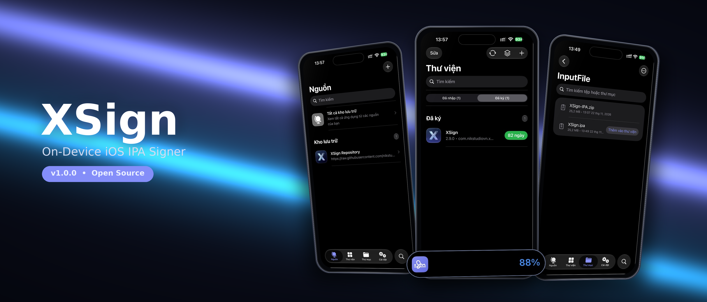
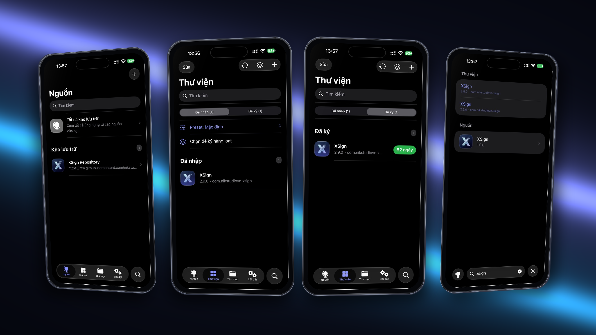
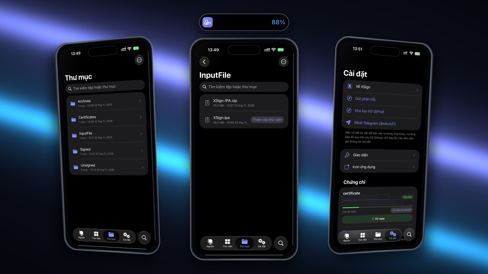

<div align="center">



# XSign

**Công cụ ký và cài đặt tệp `.ipa` miễn phí, mã nguồn mở trực tiếp trên iPhone & iPad**


</div>

---

## Giới thiệu

**XSign** là ứng dụng ký và cài đặt tệp `.ipa` trực tiếp trên thiết bị iOS/iPadOS (sử dụng chứng chỉ Apple Developer Program), được phát triển và tùy biến sâu từ [XSign](https://github.com/claration/feather). XSign tập trung vào tốc độ ký gọn nhẹ, giao diện chuẩn iOS hiện đại, hỗ trợ tiếng Việt đầy đủ và hoàn toàn không theo dõi người dùng hay chèn quảng cáo.

---

## Tính năng nổi bật

### Ký & Cài đặt nhanh gọn
- **Ký & cài 1 chạm (Semi Local OTA):** Tự động ký lại `.ipa` ngay trên thiết bị và mở thẳng hộp thoại cài đặt của iOS, bỏ qua trang Safari trung gian và cảnh báo kết nối không an toàn.
- **Đổi chứng chỉ riêng cho từng IPA:** Nhấn giữ bất kỳ ứng dụng nào trong **Thư viện** để chọn chứng chỉ cài nhanh riêng cho riêng app đó (hiển thị nhãn chứng chỉ ngay trên dòng ứng dụng).
- **Ký hàng loạt & Preset ký:** Lưu sẵn các bộ cấu hình ký (Preset) và chọn nhiều ứng dụng để ký nối tiếp trong một lần.
- **Tùy biến sâu & hỗ trợ Tweak:** Đổi tên, biểu tượng, Bundle ID, phiên bản, bật chia sẻ ứng dụng Tệp (Files), vá tương thích Liquid Glass và chèn `.dylib` / `.deb` thông qua **ElleKit**.

### Quản lý Nguồn & Thư mục tiện lợi
- **Kho nguồn AltStore sẵn sàng:** Tự động tích hợp và ghim sẵn **XSign Repository** ở đầu danh sách, kèm kho **Nguồn đề xuất** cho phép thêm chỉ với 1 chạm.
- **Trình duyệt thư mục tích hợp:** Quản lý trực tiếp các thư mục `Archives`, `Certificates`, `InputFile`, `Signed`, `Unsigned`; giải nén `.zip` và bấm **"Thêm vào thư viện"** ngay trên từng tệp `.ipa` / `.tipa`.

### Trải nghiệm hiện đại & An toàn
- **Dynamic Island & Live Activity:** Theo dõi trực tiếp tiến độ ký và cài đặt theo thời gian thực ngay ngoài màn hình chính và màn hình khóa.
- **Tìm kiếm toàn cục:** Quét đồng thời **Thư viện**, **Nguồn đã tải** và **Cài đặt** (hỗ trợ từ khóa tiếng Việt).
- **Giao diện tối ưu iOS 16–26:** Thanh điều hướng Liquid Glass trên iOS 18+, Sidebar cho iPad, màn hình giới thiệu Onboarding 4 bước và nền 2 dải gradient chéo dịu mắt.
- **Ổn định & minh bạch:** Kiểm tra tính hợp lệ của tệp thực thi Mach-O trước khi đưa vào `Zsign`, xử lý Core Data an toàn đa luồng, kiểm tra trạng thái chứng chỉ OCSP, mã nguồn mở theo giấy phép **GNU GPL v3.0**.

---

## Giao diện thực tế

### Nguồn, Thư viện & Tìm kiếm toàn cục
<div align="center">
  
</div>

### Quản lý thư mục, nhập IPA từ `InputFile`, Cài đặt & Dynamic Island
<div align="center">
  
</div>

---

## Điểm khác biệt so với XSign gốc

| Hạng mục | XSign gốc | XSign (`v1.0.0`) |
| :--- | :--- | :--- |
| **Định danh & URL Scheme** | XSign | `com.nikstudiovn.xsign` / `xsign://` |
| **Cài đặt qua máy chủ** | Fully Local (`backloop.dev`) / Semi Local | Luôn dùng **Semi Local OTA** (bỏ `backloop.dev` đã ngừng hoạt động), tự mở popup cài đặt |
| **Thao tác Thư viện** | Menu chung | Nhấn 1 lần mở menu thao tác; **nhấn giữ** đổi chứng chỉ cài nhanh riêng cho từng IPA kèm nhãn hiển thị |
| **Quản lý tệp** | Chỉ nhập qua bộ chọn tệp | Tích hợp tab **Thư mục** với nút **Thêm vào thư viện** trực tiếp cho `.ipa` / `.tipa` trong `InputFile` |
| **Dynamic Island** | Không có | Hiển thị tiến độ ký/cài thời gian thực với 1 thanh tiến độ tinh gọn |
| **Độ ổn định & bảo vệ** | — | Bọc Core Data `context.perform`, chặn lưu khi ký lỗi, kiểm tra tồn tại chứng chỉ & validate Mach-O trước khi gọi Zsign |

---

## Cài đặt

1. Tải tệp `XSign.ipa` mới nhất tại mục [Releases](https://www.google.com/search?q=https://github.com/nikstudiovn/XSign/releases/latest).
2. Ký và cài đặt bằng chứng chỉ Apple Developer của bạn (hỗ trợ các chứng chỉ Wildcard hoặc Explicit App ID).
3. Mở XSign, nhập chứng chỉ `.p12` + `.mobileprovision` (hoặc tệp `.zip` chứa bộ chứng chỉ) trong **Cài đặt → Chứng chỉ** và bắt đầu sử dụng.

**Thêm nguồn XSign vào các trình ký hỗ trợ AltStore:**
```text
https://raw.githubusercontent.com/nikstudiovn/XSign/refs/heads/main/app-repo.json
```

---

## Tự build từ mã nguồn

Yêu cầu **macOS** kèm **Xcode** mới nhất:

```bash
git clone --recursive https://github.com/nikstudiovn/XSign.git
cd XSign
make
```

Tệp `.ipa` sau khi build sẽ nằm trong thư mục `packages/XSign.ipa`.

---

## Ghi nhận (Acknowledgements)

XSign được xây dựng dựa trên nền tảng và các dự án mã nguồn mở tuyệt vời sau:
- [Samara / XSign](https://github.com/claration/feather) — Nền tảng ứng dụng gốc.
- [Zsign](https://github.com/zhlynn/zsign) — Engine ký mã iOS đa nền tảng.
- [IDeviceKitten](https://www.google.com/search?q=https://github.com/claration/IDeviceKitten), [ElleKit](https://github.com/tealbathingsuit/ellekit), [Vapor](https://github.com/vapor/vapor), [LiveContainer](https://github.com/khanhduytran0/LiveContainer), [Nuke](https://github.com/kean/Nuke), [Asspp](https://github.com/Lakr233/Asspp).

## Giấy phép

Dự án được phát hành theo giấy phép **GNU General Public License v3.0 (GPL-3.0)**. Xem chi tiết tại tệp [LICENSE](https://www.google.com/search?q=LICENSE).
